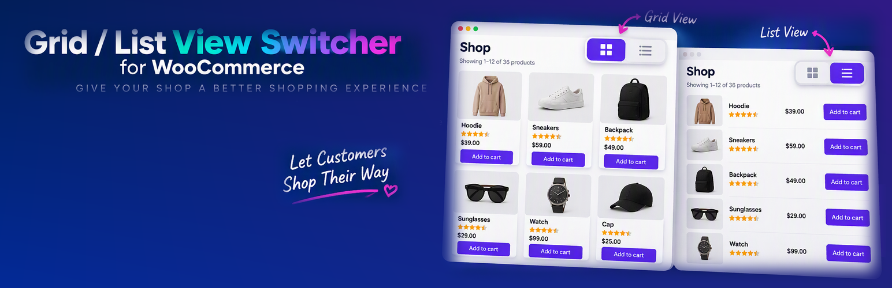

# Grid/List View Switcher for WooCommerce



ปลั๊กอิน WooCommerce สำหรับสลับมุมมองสินค้าแบบ Grid / List พร้อม Quick View popup และแผงตัวกรองหมวดหมู่ / ช่วงราคา

> ไฟล์ `readme.txt` (ภาษาอังกฤษ) คือไฟล์ที่ WordPress.org ใช้แสดงในหน้าปลั๊กอิน ไฟล์นี้เป็นคู่มือภาษาไทยสำหรับ GitHub

## การติดตั้ง

1. ติดตั้งและเปิดใช้ WooCommerce
2. อัปโหลดโฟลเดอร์ปลั๊กอินไปที่ `/wp-content/plugins/` แล้วกดเปิดใช้งาน
3. ไปที่ **WooCommerce > View Switcher** เพื่อตั้งค่า

## การใช้งาน

### หน้าร้านค้าและหน้าหมวดหมู่

เมื่อเปิดใช้งาน ปุ่มสลับ Grid/List, ปุ่ม Quick View และแผงตัวกรองจะแสดงอัตโนมัติในหน้า Shop, หน้าหมวดหมู่/แท็กสินค้า และผลการค้นหาสินค้า ไม่ต้องตั้งค่าเพิ่ม

### การตั้งค่า (WooCommerce > View Switcher)

| ตัวเลือก | ความหมาย |
|---|---|
| Default view | มุมมองเริ่มต้นสำหรับผู้เข้าชมครั้งแรก (Grid หรือ List) |
| Columns | จำนวนคอลัมน์ในมุมมอง Grid บนจอใหญ่ (1–6) |
| Details button text | ข้อความปุ่มรายละเอียดในมุมมอง List |
| Enable Quick View / Quick View button text | เปิดปิดปุ่ม Quick View และข้อความบนปุ่ม |
| Enable filters | เปิดปิดแผงตัวกรอง |
| Filter panel default state | ให้แผงกรองเปิดหรือปิดไว้ตอนเริ่มบนคอมพิวเตอร์ (บนมือถือจะเป็นแถบเลื่อนและปิดไว้เสมอ) |
| Filters to show | เลือกแสดงตัวกรองหมวดหมู่, จำนวนสินค้าในหมวด และช่วงราคา |

ช่องข้อความถ้าเว้นว่าง จะใช้ข้อความเริ่มต้นซึ่งแปลภาษาได้

### Shortcode `[wcvs_products]`

ใส่ในหน้าเพจหรือโพสต์ใดก็ได้ เพื่อแสดงสินค้าพร้อมแถบเครื่องมือ Quick View และตัวกรองแบบเดียวกับหน้า Shop ใช้ attribute ได้ทุกตัวเหมือน `[products]` ของ WooCommerce

| Attribute | ความหมาย |
|---|---|
| `limit` | จำนวนสินค้าต่อหน้า (ค่าเริ่มต้น 12) |
| `columns` | จำนวนคอลัมน์ |
| `category` | slug หมวดหมู่ คั่นหลายหมวดด้วยจุลภาค |
| `tag` | slug แท็ก คั่นด้วยจุลภาค |
| `ids` / `skus` | แสดงเฉพาะสินค้าที่ระบุ |
| `orderby` / `order` | การเรียงลำดับ เช่น `orderby="price" order="ASC"` ถ้าเว้นว่างจะใช้ค่าจากเมนู Sort by |
| `on_sale`, `best_selling`, `top_rated` | ใส่ `"true"` เพื่อแสดงเฉพาะสินค้าลดราคา ขายดี หรือคะแนนสูง |
| `filter` | ใส่ `"false"` เพื่อซ่อนแผงตัวกรองในหน้านั้น (เฉพาะปลั๊กอินนี้) |

ตัวอย่าง

```
[wcvs_products]
[wcvs_products limit="24" category="boxes"]
[wcvs_products on_sale="true" orderby="price" order="ASC"]
[wcvs_products category="gifts" filter="false"]
```

### ลิงก์แบบระบุมุมมองหรือตัวกรอง

- เติม `?wcvs_view=list` หรือ `?wcvs_view=grid` ท้าย URL หน้าร้านเพื่อเปิดในมุมมองที่ต้องการ
- ตัวกรองใช้พารามิเตอร์ `wcvs_cat`, `min_price`, `max_price` เช่น `?wcvs_cat=boxes&min_price=100&max_price=500`

## ความเป็นส่วนตัว

ปลั๊กอินไม่เก็บข้อมูลส่วนบุคคลและไม่เชื่อมต่อบริการภายนอก ใช้คุกกี้เพื่อจำการตั้งค่าการแสดงผลเท่านั้น ได้แก่ `wcvs_view` (มุมมองที่เลือก) และ `wcvs_filter` (สถานะแผงกรอง) อายุ 1 ปี

## License

GPLv2 or later
